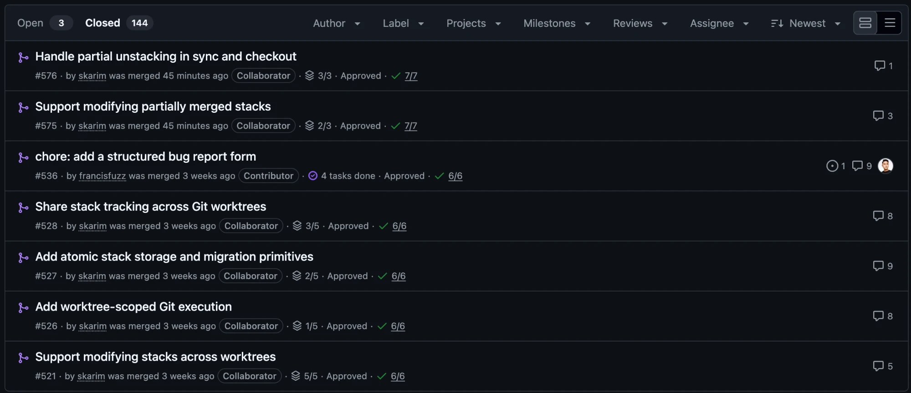
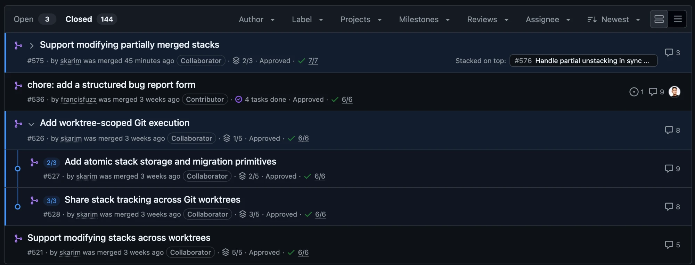

# PR Stack Grouping for GitHub

A Chrome extension that groups stacked pull requests in the GitHub PR list into a single expandable row.

Not affiliated with or endorsed by GitHub.

Before:



After:



A PR whose base branch is another PR's head branch is treated as part of that PR's stack. The stack shows as one row under its root PR; click the chevron to expand it.

## Install

From source (Chrome, Edge, or any Chromium browser):

1. Clone this repository.
2. Open `chrome://extensions` and enable **Developer mode**.
3. Click **Load unpacked** and select the repository folder.
4. Open any repository's `/pulls` page on github.com.

## Usage

Use the toolbar popup to turn grouping on or off. When off, the toolbar icon shows an `OFF` badge and the PR list is left unchanged.

## How it works

For each PR in the list, the content script fetches its hovercard from github.com to read the base and head branches, then nests PRs whose base matches another PR's head. Branch names are cached locally for 30 days so a reload can group rows immediately. No data leaves your browser. See [PRIVACY.md](PRIVACY.md).

GitHub does not expose a stack identifier, so grouping relies on branch relationships and on GitHub's current list markup; a GitHub UI change may break it.

## Packaging

```sh
npm run package
```

Creates `dist/github-pr-stack-extension.zip` for upload to the Chrome Web Store.

## License

[MIT](LICENSE)
